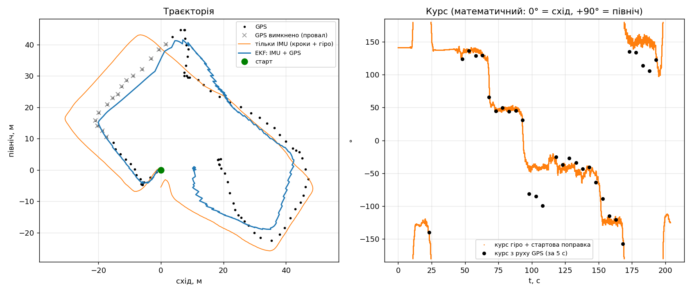
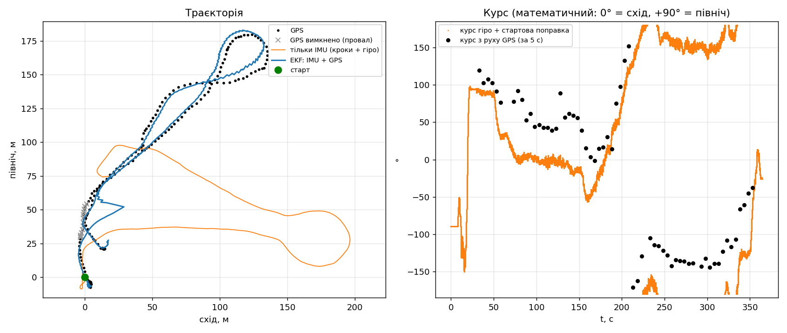
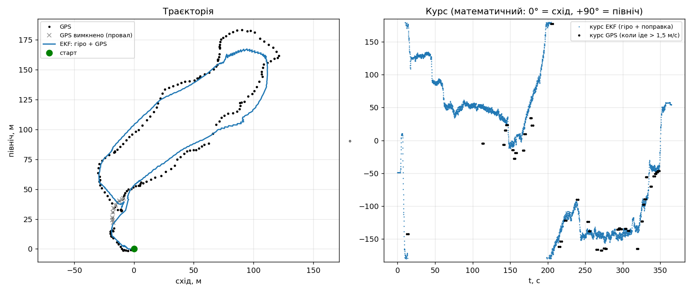

# Експерименти: тести IMU і GPS

← [Назад до головної сторінки проєкту](https://github.com/yelgor/Controlled_Water_Non-pilotic_Drone)

| Папка | Що це |
|---|---|
| [`imu_test/`](imu_test) | тести IMU і GPS на ESP32-S3: прошивка, Python-інструменти, графіки й звіти |

## Що перевіряли

Плату ESP32-S3 з IMU і GPS NEO-6M носили в руках по маршруту і записували все в CSV.
Потім офлайн порівнювали три способи знайти, де ми і куди дивимось:

- **тільки GPS** — чорні точки;
- **тільки IMU** (курс з гіроскопа + кроки) — помаранчева лінія;
- **EKF: IMU + GPS** — синя лінія, фільтр, який поєднує обидва.

Сірі хрестики — ділянка, де GPS навмисно «вимкнули» в обробці, щоб побачити, скільки фільтр протримається без нього.
Праворуч на кожному графіку — курс з гіроскопа проти курсу з руху за GPS.

## Результати

### Прогулянка 1 — 204 с, ~196 м, 10 супутників (HDOP 1,3)

| | Відхилення в кінці від GPS |
|---|---|
| тільки IMU | 20,3 м |
| **EKF: IMU + GPS** | **7,7 м** |
| 30 с без GPS | максимум 11,1 м |

### Прогулянка 2 — 364 с, ~502 м, 12 супутників (HDOP 0,9)

| | Відхилення в кінці від GPS |
|---|---|
| тільки IMU | 53,3 м |
| **EKF: IMU + GPS** | **5,9 м** |
| 30 с без GPS | максимум 25,7 м |

### Запис 3 — 365 с, ~509 м, 7 супутників (HDOP 1,9), гіро + GPS без крокоміра

| | Значення |
|---|---|
| дрейф гіро | +15° за 6,1 хв |
| EKF у кінці від GPS | 2,0 м |
| 20 с без GPS | максимум 11,7 м |
| GPS: фініш = старт, а показав різницю | 34,3 м (мало супутників) |

## Висновки

1. **Тільки IMU не вистачає**: за кілька хвилин набігає 20–50 м похибки. Гіро тримає форму маршруту,
   але курс поступово з'їжджає.
2. **EKF IMU + GPS** тримає трек у межах 2–8 м від GPS і переживає короткі провали GPS (20–30 с) з похибкою ~11 м.
3. **Якість GPS залежить від супутників**: при 7 супутниках трек зсувається на 25–35 м,
   при 9–12 — збіг 2–5 м. Стартувати після ≥ 9–10 супутників.
4. **Гіро NXP FXAS21002** дрейфує ~0,3 °/хв у спокої, **LSM9DS1** — ~2,5 °/хв. Для катера беремо NXP.

Детальніше про інструменти і всі цифри — у [`imu_test/README.md`](imu_test/README.md).
