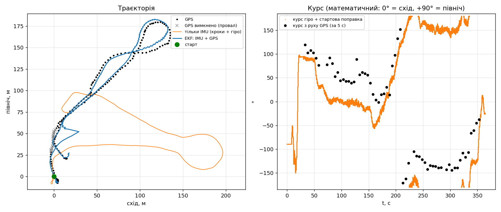

# Controlled Water Non-pilotic Drone

Водний безпілотний катер-аероглісер на ESP32-S3: один безщітковий мотор з повітряним пропелером,
серво повертає кермо в потоці повітря. Керування з пульта RadioMaster TX12 (ELRS/CRSF),
сенсори — IMU (NXP FXOS8700 + FXAS21002 або LSM9DS1) і GPS NEO-6M.

Мета — від ручного керування до утримання курсу і швидкості (PID) і автономного руху.

**Команда КВН:** Владислав Ткачук, Назар Рожко, Захар Колодчак, Матвій Піх.

## Де що лежить

Кожна частина проєкту — в окремій гілці. Натисни на назву, щоб відкрити.

| Частина | Гілка | Що всередині | Стан |
|---|---|---|---|
| **Прошивка катера** | [`feature/pid-control`](https://github.com/yelgor/Controlled_Water_Non-pilotic_Drone/tree/feature/pid-control) | основна прошивка: режими, PID курсу і швидкості, безпека, лог у flash, консоль, тести; скрипти для логів і карти; документація | ✅ катер пливе з пульта, PID налаштовується |
| **Симуляція** | [`simulation`](https://github.com/yelgor/Controlled_Water_Non-pilotic_Drone/tree/simulation) | Gazebo Sim 8 + ROS 2 Jazzy: модель катера, EKF, PID, маршрути, результати | ✅ готова |
| **Експерименти** | [`experiment`](https://github.com/yelgor/Controlled_Water_Non-pilotic_Drone/tree/experiment) | тести IMU і GPS: дрейф гіро, калібрування, EKF гіро + GPS | 🔄 в процесі |
| **Залізо** | [`hardware`](https://github.com/yelgor/Controlled_Water_Non-pilotic_Drone/tree/hardware) | перша прошивка серво + мотор, інструкції (прив'язка пульта, LSM9DS1) | ⏳ плата ще не розведена |
| **Допоміжний софт** | [`software`](https://github.com/yelgor/Controlled_Water_Non-pilotic_Drone/tree/software) | тест серво, стара прошивка ручного керування, планувальник задач | 📦 архів і тести |

## Детальніше по гілках

### [`feature/pid-control`](https://github.com/yelgor/Controlled_Water_Non-pilotic_Drone/tree/feature/pid-control) — прошивка катера

| Шлях | Що це |
|---|---|
| `firmware/` | прошивка (PlatformIO): `src/` — робота з залізом, `lib/` — логіка, `test/` — тести на ПК |
| `tools/` | злити лог з катера, графіки, карта заїзду |
| `docs/architecture.md` | як влаштована прошивка |
| `docs/pid-tuning.md` | як налаштовувати PID на воді |
| `docs/changes-2026-11-16.md` | результати перших заїздів і зміни |

### [`simulation`](https://github.com/yelgor/Controlled_Water_Non-pilotic_Drone/tree/simulation) — симуляція

| Шлях | Що це |
|---|---|
| `simulation/models/`, `worlds/` | модель катера і світ з водою |
| `simulation/scripts/` | EKF (`kf.py`), регулятор (`controller.py`), маршрути, шум сенсорів, графіки |
| `simulation/results/` | логи і графіки прогонів (квадрат, коло, вісімка, змійка…) |

Модель у симуляції відрізняється від реального катера: два мотори з реверсом, маса 1,5 кг.

### [`experiment`](https://github.com/yelgor/Controlled_Water_Non-pilotic_Drone/tree/experiment) — експерименти

| Шлях | Що це |
|---|---|
| `imu_test/src/` | прошивка тесту: IMU ~240 Гц, фільтр Madgwick, GPS, CSV у Serial |
| `imu_test/tools/` | Python: запис, аналіз і варіація Аллана, калібрування, EKF гіро + GPS |
| `imu_test/data/` | графіки і текстові звіти тестів |

### [`hardware`](https://github.com/yelgor/Controlled_Water_Non-pilotic_Drone/tree/hardware) — залізо

| Шлях | Що це |
|---|---|
| `motor_servo/` | перша прошивка: серво + ESC з пульта через ELRS/CRSF |
| `motor_servo/docs/LSM9DS1.pdf` | документація на IMU |
| `Instructione_bind/bind_elrs_tx12.pdf` | як прив'язати пульт TX12 до приймача |

### [`software`](https://github.com/yelgor/Controlled_Water_Non-pilotic_Drone/tree/software) — допоміжний софт

| Шлях | Що це |
|---|---|
| `check_servo/` | тест серво з монітора порту |
| `kater_rc_old/` | стара прошивка ручного керування (без GPS та IMU) |
| `schedular/` | двоядерний планувальник задач з самовідновленням IMU (ранній каркас) |

## Результати

### Катер на воді

Перший заїзд з записом логу (`log000`): **164 м за 4,2 хв, максимум 1,5 м/с**, газ обмежено до 30 %.
На заїздах 2026-11-16 зв'язок з пультом, компас і GPS працювали без обривів. Подробиці — у
[`docs/changes-2026-11-16.md`](https://github.com/yelgor/Controlled_Water_Non-pilotic_Drone/blob/feature/pid-control/docs/changes-2026-11-16.md).


Колір треку — швидкість (синій 0 м/с → червоний 1,5 м/с), зелена точка — старт, червона — фініш.

### Навігація: IMU + GPS

Плату з IMU і GPS носили по маршруту і порівнювали: тільки GPS (чорні точки), тільки IMU (помаранчева),
фільтр EKF, що поєднує обидва (синя).

| Прогулянка 1 | Прогулянка 2 |
|---|---|
|  |  |
| тільки IMU: 20 м похибки, **EKF: 8 м** | тільки IMU: 53 м похибки, **EKF: 6 м** |

Висновок: одного IMU не вистачає, а EKF IMU + GPS тримає трек у межах кількох метрів і переживає
короткі провали GPS. Усі графіки й цифри — у [гілці `experiment`](https://github.com/yelgor/Controlled_Water_Non-pilotic_Drone/tree/experiment).

## Швидкий старт (прошивка катера)

```bash
git clone https://github.com/yelgor/Controlled_Water_Non-pilotic_Drone.git
cd Controlled_Water_Non-pilotic_Drone
git switch feature/pid-control
cd firmware
pio test -e native     # тести на ПК
pio run -e esp32s3     # зібрати прошивку
```
