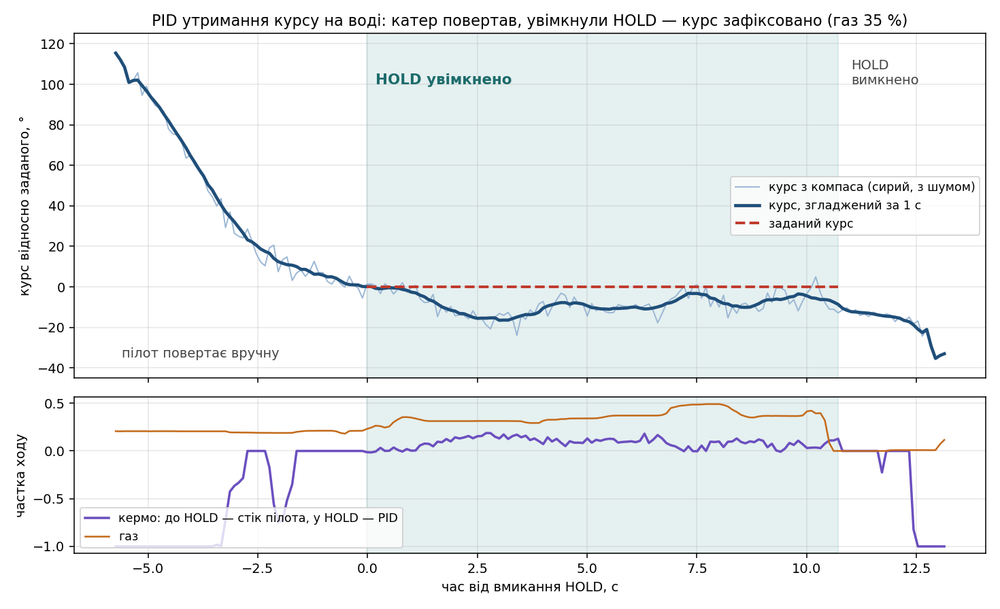
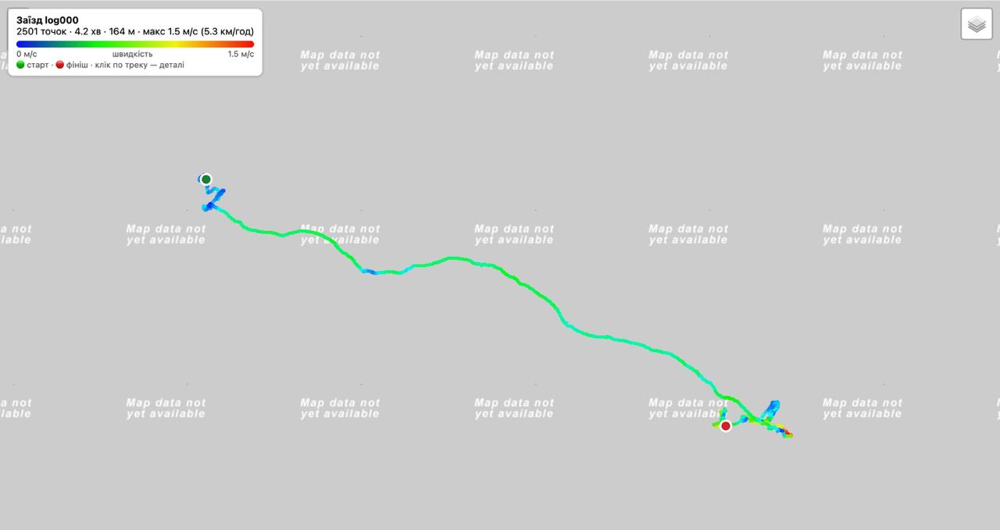
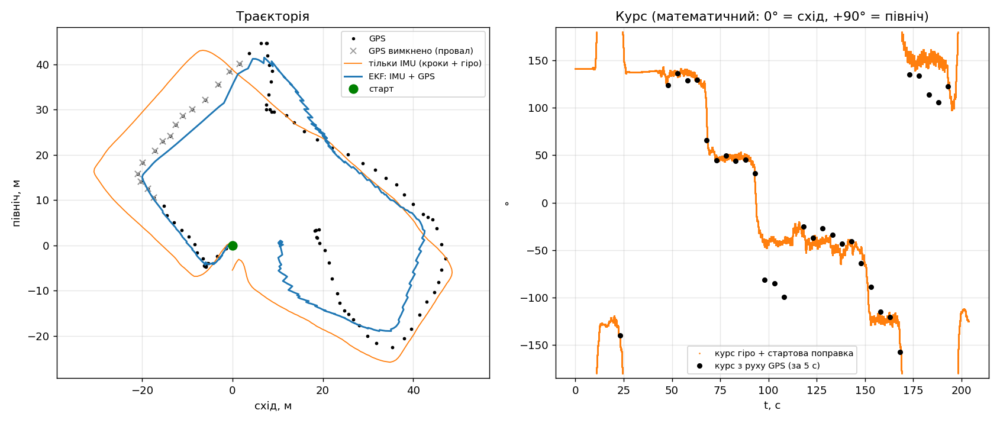

# Controlled Water Non-pilotic Drone

Водний безпілотний катер-аероглісер на ESP32-S3: один безщітковий мотор з повітряним пропелером,
серво повертає кермо в потоці повітря. Керування з пульта RadioMaster TX12 (ExpressLRS / CRSF),
сенсори — IMU (NXP FXOS8700 + FXAS21002) і GPS u-blox NEO-6M.

Мета — від ручного керування до утримання курсу і швидкості (PID) і автономного руху.

**Команда КВН:** Владислав Ткачук, Назар Рожко, Захар Колодчак, Матвій Піх.

## Стан проєкту

| | Що є | Стан |
|---|---|---|
| Ручне керування з пульта | режими, failsafe, обмеження газу й керма | ✅ працює на воді |
| **PID утримання курсу (HOLD)** | тумблер на пульті, курс з компаса | ✅ **перевірено на воді**, тримає курс; налаштування коефіцієнтів триває |
| PID утримання швидкості | швидкість з GPS | ⏳ є в прошивці, на воді не тестувався |
| Лог заїздів | flash 13 МБ, 10 рядків/с, скачування по USB | ✅ |
| Калібрування компаса | за колами на воді | ✅ метод працює; треба жорстко закріпити IMU |
| Фільтр Калмана (EKF) | IMU + GPS | ✅ у симуляції й на записаних даних; ⏳ ще не в прошивці катера |

Повний опис системи для звіту — [`docs/project-overview-for-report.md`](docs/project-overview-for-report.md):
інтерфейси і протоколи, як працюють IMU і компас, PID (коефіцієнти і тест), де є фільтр Калмана,
як працює лог, хронологія всіх заїздів.

## Де що лежить

Усе робоче злито в `main` і лежить у папках нижче. Окремо в гілці лишилося тільки залізо (плата ще
не розведена). Гілки теж лишаються: у них ведеться подальша робота.

| Частина | На `main` | Гілка | Що всередині | Стан |
|---|---|---|---|---|
| **Прошивка катера** | [`firmware/`](firmware), [`tools/`](tools), [`docs/`](docs), [`FIRMWARE.md`](FIRMWARE.md) | [`feature/pid-control`](https://github.com/yelgor/Controlled_Water_Non-pilotic_Drone/tree/feature/pid-control) | режими, PID курсу і швидкості, безпека, лог у flash, консоль, тести на ПК; скрипти для логів, карти й калібрування; документація | ✅ PID курсу перевірено на воді |
| **Симуляція** | [`simulation/`](simulation) | [`simulation`](https://github.com/yelgor/Controlled_Water_Non-pilotic_Drone/tree/simulation) | Gazebo Sim 8 + ROS 2 Jazzy: модель катера, EKF, PID, маршрути, результати | ✅ готова |
| **Допоміжний софт** | [`check_servo/`](check_servo), [`kater_rc_old/`](kater_rc_old), [`schedular/`](schedular) | [`software`](https://github.com/yelgor/Controlled_Water_Non-pilotic_Drone/tree/software) | тест серво, стара прошивка ручного керування, планувальник задач | 📦 архів і тести |
| **Експерименти** | [`imu_test/`](imu_test), [`EXPERIMENTS.md`](EXPERIMENTS.md) | [`experiment`](https://github.com/yelgor/Controlled_Water_Non-pilotic_Drone/tree/experiment) | тести IMU і GPS: дрейф гіро, калібрування, EKF гіро + GPS; код і дані | ✅ результати є |
| **Залізо** | — | [`hardware`](https://github.com/yelgor/Controlled_Water_Non-pilotic_Drone/tree/hardware) | перша прошивка серво + мотор, інструкції (прив'язка пульта, LSM9DS1) | ⏳ плата ще не розведена |

### Прошивка: `firmware/`, `tools/`, `docs/`

| Шлях | Що це |
|---|---|
| [`firmware/`](firmware) | прошивка (PlatformIO): `src/` — робота з залізом, `lib/` — логіка, `test/` — тести на ПК (80) |
| [`tools/get_log.py`](tools/get_log.py) | злити логи з катера по USB (`list`, номер, `all`) |
| [`tools/plot_log.py`](tools/plot_log.py), [`tools/map_log.py`](tools/map_log.py) | графіки заїзду і карта треку |
| [`tools/calib_from_log.py`](tools/calib_from_log.py) | калібрування компаса за колами на воді |
| [`tools/calib_mag.py`](tools/calib_mag.py), [`tools/calib_imu.py`](tools/calib_imu.py) | калібрування компаса по USB |
| [`docs/project-overview-for-report.md`](docs/project-overview-for-report.md) | **опис системи і результати для звіту** |
| [`docs/results-2026-11-18.md`](docs/results-2026-11-18.md) | результати заїздів 18.11 |
| [`docs/architecture.md`](docs/architecture.md) | як влаштована прошивка |
| [`docs/pid-tuning.md`](docs/pid-tuning.md) | як налаштовувати PID на воді |
| [`docs/changes-2026-11-16.md`](docs/changes-2026-11-16.md), [`docs/changes-2026-11-18.md`](docs/changes-2026-11-18.md) | журнал змін і стан заліза |

### Симуляція: `simulation/`

| Шлях | Що це |
|---|---|
| `simulation/models/`, `worlds/` | модель катера і світ з водою |
| `simulation/scripts/` | EKF (`kf.py`), регулятор (`controller.py`), маршрути, шум сенсорів, графіки |
| `simulation/results/` | логи і графіки прогонів (квадрат, коло, вісімка, змійка…) |

Модель у симуляції відрізняється від реального катера: два мотори з реверсом, маса 1,5 кг.

### Допоміжний софт

| Шлях | Що це |
|---|---|
| [`check_servo/`](check_servo) | тест серво з монітора порту |
| [`kater_rc_old/`](kater_rc_old) | стара прошивка ручного керування (без GPS та IMU) |
| [`schedular/`](schedular) | двоядерний планувальник задач з самовідновленням IMU (ранній каркас) |

### Експерименти: `imu_test/` (опис — [`EXPERIMENTS.md`](EXPERIMENTS.md))

| Шлях | Що це |
|---|---|
| [`imu_test/src/`](imu_test/src) | прошивка тесту: IMU ~240 Гц, фільтр Madgwick, GPS, CSV у Serial |
| [`imu_test/tools/`](imu_test/tools) | Python: запис, аналіз і варіація Аллана, калібрування, EKF гіро + GPS |
| [`imu_test/data/`](imu_test/data) | графіки і текстові звіти тестів (сирі CSV не додані: великі й з координатами) |

### Гілка [`hardware`](https://github.com/yelgor/Controlled_Water_Non-pilotic_Drone/tree/hardware)

| Шлях | Що це |
|---|---|
| `motor_servo/` | перша прошивка: серво + ESC з пульта через ELRS/CRSF |
| `motor_servo/docs/LSM9DS1.pdf` | документація на IMU |
| `Instructione_bind/bind_elrs_tx12.pdf` | як прив'язати пульт TX12 до приймача |

## Результати

### PID утримання курсу на воді



До вмикання HOLD пілот повертав катер (курс змінився на ~120° за 6 с). Після вмикання регулятор
**зупинив поворот і 10 с утримував курс**; кермо від PID реагує в правильний бік (кореляція +0,95).

- Тонка світла лінія — сирий курс з компаса: «тремтіння» 3–6° за 0,1 с — шум магнітометра, а не рух катера
  (на відео катер іде рівно).
- Стала похибка ~10° — очікувана для чистого P-регулятора (`Kp = 0,01`, `Ki = Kd = 0`): щоб протидіяти
  постійному моменту від пропелера, кермо має стояти на ~0,1, а P дає це лише за похибки 0,1 / 0,01 = 10°.
  Наступний крок — `Kp = 0,02` і `Ki = 0,003`.

### Що з'ясували на заїздах

На перших заїздах було кілька помилок, які знайшли за логами й виправили:
кермо працювало навпаки (стік вправо — катер вліво), відійшов дріт IMU, тумблер HOLD був на іншому каналі,
ніж надсилає пульт, а при скачуванні логів губилась частина рядків.

| Що | Результат |
|---|---|
| Зв'язок з пультом (ELRS) | 100 % без обривів |
| Швидкість | 0,6–0,7 м/с у воді на 20–38 % газу, 0,8–1,0 м/с на 35–50 % |
| Кермо | напрям виправлено (`rud.rev 1`); на газі пропелер крутить катер вправо — компенсується тримом `rud.trim 0.09` |
| Компас | калібрування методом еліпса за колами; зсувається, якщо батарея й дроти біля IMU лягають інакше |
| Течія | ~0,03 м/с — на рух катера майже не вплинула |
| Лог | спочатку при скачуванні губилось 25–70 % рядків — виправлено, тепер 100 % |

Подробиці і всі цифри — у [`docs/project-overview-for-report.md`](docs/project-overview-for-report.md).

### Траєкторії всіх заїздів


Метри від точки старту (без координат), колір — швидкість за GPS, товста лінія — режим HOLD.

| Заїзд | Що видно на треку |
|---|---|
| 1 | найдовший заїзд: ~100 м від старту, але компас не працював (відійшов дріт IMU) |
| 2 | кола для калібрування компаса: радіус 1–3 м, тому на GPS це «клубок» 10×13 м; за компасом — ~7 обертів |
| 3 | катер уже їде (~0,6 м/с у воді); кермо ще працювало навпаки, тому траєкторія рвана |
| 4 | кермо виправлено; видно, як на газі катер закручується вправо навіть з центральним кермом |
| 5 | кола й прямі для калібрування та триму; великі петлі — катер кружляв, доки трим був у неправильний бік |
| 6 | тест PID (товста лінія — HOLD); GPS тут недостовірний: плата перезапускалась від просідання батареї, і після кожного перезапуску GPS «підтягував» координати (червоне — артефакт) |

Окремі картинки кожного заїзду — [`docs/img/tracks/`](docs/img/tracks).

### Перший заїзд з логом

Перший заїзд з записом логу (`log000`): **164 м за 4,2 хв, максимум 1,5 м/с**, газ обмежено до 30 %.



Колір треку — швидкість (синій 0 м/с → червоний 1,5 м/с), зелена точка — старт, червона — фініш.

### Навігація: IMU + GPS (фільтр Калмана)

Плату з IMU і GPS носили по маршруту і порівнювали: тільки GPS (чорні точки), тільки IMU (помаранчева),
фільтр EKF, що поєднує обидва (синя).

| Прогулянка 1 | Прогулянка 2 |
|---|---|
|  |  |
| тільки IMU: 20 м похибки, **EKF: 8 м** | тільки IMU: 53 м похибки, **EKF: 6 м** |

Висновок: одного IMU не вистачає, а EKF IMU + GPS тримає трек у межах кількох метрів і переживає
короткі провали GPS. У прошивці катера фільтра Калмана поки немає — це наступний крок.

## Швидкий старт (прошивка катера)

```bash
git clone https://github.com/yelgor/Controlled_Water_Non-pilotic_Drone.git
cd Controlled_Water_Non-pilotic_Drone/firmware
pio test -e native     # тести на ПК (80)
pio run -e esp32s3     # зібрати прошивку
pio run -e esp32s3 -t upload
```

Після заїзду (плата по USB, пульт вимкнений):

```bash
python3 tools/get_log.py all          # злити всі логи
python3 tools/plot_log.py log000.csv  # графіки
python3 tools/map_log.py log000.csv   # карта треку
```

Логи заїздів у гіт не додаються: вони містять точні GPS-координати.
