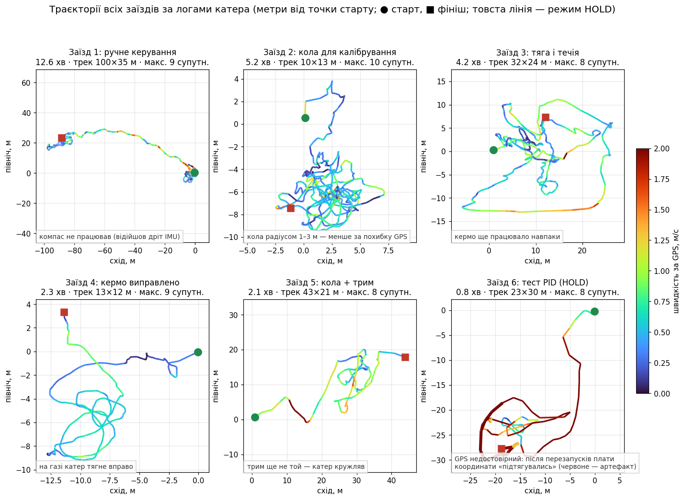

# Прошивка катера: PID курсу і швидкості

Гілка `feature/pid-control` — **основна прошивка** водного дрона-аероглісера на ESP32-S3.
Пілот керує з пульта (ELRS), а тумблер HOLD вмикає режим, у якому катер сам тримає курс
і, за бажанням, задану швидкість.

← [Назад до головної сторінки проєкту](https://github.com/yelgor/Controlled_Water_Non-pilotic_Drone)

## Стан

**Станом на 19.11.2026** (подробиці — [docs/project-overview-for-report.md](docs/project-overview-for-report.md)):

- ✅ **PID утримання курсу протестовано на воді**: після вмикання HOLD регулятор зупиняє поворот і тримає
  курс; кермо реагує в правильний бік (кореляція +0,95). Стала похибка ~10° — бо поки лише P
  (`hdg.kp = 0.01`, I = D = 0); наступний крок — `hdg.kp 0.02`, `hdg.ki 0.003`.
- ✅ Зв'язок з пультом стабільний (100 % у заїздах 18–19.11), GPS до 9–10 супутників.
- ✅ Логи скачуються повністю (виправлено `log dump`).
- ✅ Кермо: реверс `rud.rev 1`, трим `rud.trim 0.09`, хід `rud.max 0.8`, плавність `rud.rate 2.5`.
- ⚠️ Калібрування компаса зсувається між заїздами (батарея й дроти біля IMU лягають щоразу інакше) —
  треба жорстко закріпити і перекалібрувати (`tools/calib_from_log.py` за колами на воді).
- ⚠️ Під кінець заїздів плата перезапускалась на ходу — просідання батареї.
- Тестовий режим: ARM не потрібен (`kArmSwitchBypass = true`), тумблер HOLD працює (`kHoldSwitchInBypass = true`).
- Фільтра Калмана в прошивці поки немає (є в симуляції та експериментах).


### Траєкторії заїздів 1–6



Метри від точки старту (координат немає), колір — швидкість за GPS, товста лінія — режим HOLD.
Окремі картинки — [`docs/img/tracks/`](docs/img/tracks). Що в кожному заїзді —
[docs/project-overview-for-report.md](docs/project-overview-for-report.md), розділ 12.

### Заїзд `log000`: 164 м за 4,2 хв, максимум 1,5 м/с


Колір треку — швидкість (синій 0 м/с → червоний 1,5 м/с), зелена точка — старт, червона — фініш.
Карта побудована скриптом `tools/map_log.py` з логу катера.

## Документація

| Файл | Про що |
|---|---|
| [docs/architecture.md](docs/architecture.md) | як влаштована прошивка: цикл, модулі, тести |
| [docs/pid-tuning.md](docs/pid-tuning.md) | як налаштовувати PID на воді, крок за кроком |
| [docs/changes-2026-11-16.md](docs/changes-2026-11-16.md) | що змінено після перших заїздів, результати, відомі проблеми |
| [docs/changes-2026-11-18.md](docs/changes-2026-11-18.md) | компас у гаусах, команди `imu`/`raw`, стан заліза 18.11 |
| [docs/results-2026-11-18.md](docs/results-2026-11-18.md) | результати заїздів 1–2: GPS, IMU, калібрування, тяга |
| [docs/project-overview-for-report.md](docs/project-overview-for-report.md) | **для звіту**: протоколи, IMU, PID, фільтр Калмана, лог, заїзди 1–6 |
| [CLAUDE.md](CLAUDE.md) | коротка довідка: залізо, піни, вимоги до PID, безпека, команди |

## Залізо

| Елемент | Модель | Піни (`firmware/include/config.h`) |
|---|---|---|
| Контролер | ESP32-S3 N16R8 | — |
| IMU + компас | NXP FXOS8700 + FXAS21002 або LSM9DS1 (визначається сам) | I2C: SDA 8, SCL 9 |
| GPS | NEO-6M, 5 Гц | RX 16, TX 15 |
| Приймач | ELRS, протокол CRSF 420000 бод | RX 18, TX 17 |
| Мотор | безщітковий + повітряний пропелер, ESC Skywalker 40A (без реверсу) | GPIO 5 |
| Кермо | серво RDS3115 у потоці повітря | GPIO 4 |

Канали пульта: CH1 кермо, CH3 газ, CH5 ARM, **CH8 HOLD** (тумблер SC на RadioMaster TX12).

## Режими

| Режим | Що відбувається |
|---|---|
| FAILSAFE | немає зв'язку з пультом > 0,5 с: газ 0, кермо в центр, DISARM |
| DISARMED | мотор вимкнено, кермо можна рухати (перевірка серво) |
| MANUAL | пілот керує сам |
| HOLD | катер тримає курс, який був у момент вмикання (і швидкість, якщо є GPS) |

## Як зібрати і запустити

Усі команди з папки `firmware/`:

```bash
pio test -e native            # тести логіки на ПК (без плати)
pio run -e esp32s3            # зібрати прошивку
pio run -e esp32s3 -t upload  # прошити плату
pio device monitor            # консоль, 115200
```

Команди консолі: `help`, `status`, `get`, `set <назва> <число>`, `save`, `load`, `defaults`,
`cal start|stop`, `log list|dump <n>|clear`, `tele on|off`, `i2c`.

## Що де лежить

Головне правило: усе, що можна перевірити без заліза, лежить у `lib/` і має тести в `test/`.
`src/` — тонкий шар, який працює з залізом.

### `firmware/` — корінь

| Файл | Що робить |
|---|---|
| `platformio.ini` | два середовища: `esp32s3` (прошивка) і `native` (тести на ПК) |
| `partitions.csv` | розмітка flash 16 МБ: програма 3 МБ + ~13 МБ під логи |
| `include/config.h` | піни, канали пульта, частоти, таймаути, тестовий режим |

### `firmware/src/` — код, що працює з залізом

| Файл | Що робить |
|---|---|
| `main.cpp` | збирає модулі разом: старт, цикл 50 Гц, watchdog, запис логу |
| `drivers/imu.*` | компас: читає акселерометр і магнітометр, рахує курс з компенсацією нахилу |
| `drivers/gps_neo6m.*` | GPS: налаштовує 5 Гц, віддає швидкість, координати, кількість супутників |
| `drivers/rc_crsf.*` | приймач ELRS: стіки й тумблери для `Vehicle` |
| `drivers/actuators.*` | серво керма і ESC: імпульси 50 Гц |
| `storage/param_store.*` | збереження параметрів у NVS (не губляться після вимкнення) |
| `storage/flight_log.*` | лог заїздів у flash: новий файл `/logNNN.csv` на кожен ARM, пише окрема задача на ядрі 0 |
| `console/serial_console.*` | консоль на березі: команди з ноутбука по USB |

### `firmware/lib/` — логіка без заліза

| Файл | Що робить |
|---|---|
| `core/vehicle.*` | «мозок»: режими, безпека, з'єднує регулятори; отримує числа, віддає імпульси PWM |
| `core/params.h` | усі налаштування, які можна змінити з консолі (обережні значення за замовчуванням) |
| `control/pid.*` | універсальний PID: реальний dt, anti-windup, фільтр D, обмеження виходу |
| `control/heading_controller.*` | регулятор курсу: курс з компаса → положення керма |
| `control/speed_controller.*` | регулятор швидкості: швидкість з GPS → газ |
| `control/mixer.h` | кермо + газ → імпульси PWM; тут же загальний ліміт газу `thr.max` |
| `control/angle.h` | робота з кутами (перехід через 0°/360°) |
| `nav/heading_math.h` | курс з компаса з компенсацією нахилу (катер хитається на хвилях) |
| `nav/mag_calibration.h` | калібрування магнітометра (hard iron + soft iron) |
| `rc/crsf_parser.*` | розбір протоколу CRSF |
| `tuning/command_parser.*` | розбір текстових команд консолі |
| `tuning/param_table.*` | таблиця параметрів: назва в консолі ↔ поле в `Params`, допустимий діапазон |
| `telemetry/telemetry_csv.h` | формат рядка логу (однаковий для flash і для `tele on`) |

### `firmware/test/` — тести (Unity, запускаються на ПК)

| Папка | Що перевіряє |
|---|---|
| `test_pid` | PID і кути: dt, anti-windup, фільтр D, обмеження, плавне перемикання, NaN |
| `test_heading` | регулятор курсу: поворот найкоротшим шляхом, I заморожується без потоку повітря |
| `test_speed` | регулятор швидкості: газ не від'ємний, без GPS газ скидається |
| `test_mixer` | мікшер: центр, тример, ліміт газу 30 %, NaN |
| `test_sensors` | курс з компаса з нахилом, калібрування магнітометра, протокол CRSF |
| `test_tuning` | команди консолі, таблиця параметрів, формат CSV |
| `test_vehicle` | режими і безпеку: ARM лише при газі 0, втрата пульта, HOLD, тестовий режим |

### `tools/` — скрипти на ноутбуці (Python)

| Файл | Що робить |
|---|---|
| `get_log.py` | злити лог заїзду з катера по USB: `python3 tools/get_log.py <порт> <n>` |
| `plot_log.py` | графіки заїзду з CSV-логу |
| `map_log.py` | карта заїзду: трек на супутниковому знімку, колір = швидкість |

Логи і карти містять точні координати, тому в гіт не комітяться (див. `.gitignore`).
