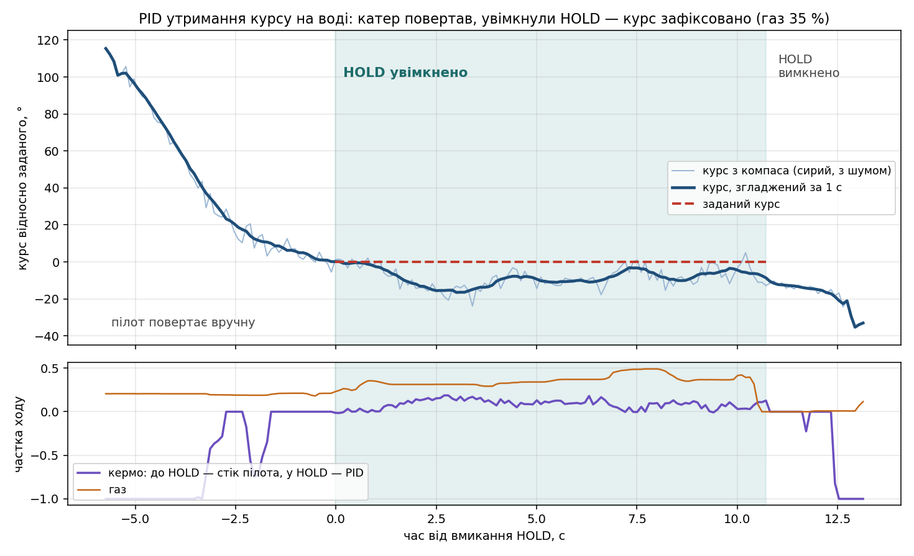

# Водний дрон-аероглісер: опис системи і результати тестів (для звіту)

Довідник для написання звіту й презентації. Усі цифри взято з коду прошивки ([`firmware/`](../firmware)), логів заїздів і
консолі плати. Там, де щось є лише планом або припущенням, це сказано прямо.

Попередній звіт з результатами 18.11 — [`results-2026-11-18.md`](results-2026-11-18.md). Графік тесту PID —
[`img/pid_hold_log014.png`](img/pid_hold_log014.png). Логи заїздів у гіт не додані: вони містять точні
GPS-координати (див. `.gitignore`), зберігаються локально.

---

## 1. Що це за система

Аероглісер: корпус без кіля, один безщітковий мотор з **повітряним пропелером**, **кермо стоїть у потоці
повітря** за пропелером (як у аероглісера на болоті). Немає реверсу.

| Вузол | Модель | Підключення до ESP32-S3 |
|---|---|---|
| Контролер | ESP32-S3 N16R8 (2 ядра, 16 МБ flash) | — |
| IMU | NXP **FXOS8700** (акселерометр + магнітометр) + **FXAS21002** (гіроскоп), модуль 9 осей | I2C: SDA 8, SCL 9; адреси 0x1F і 0x21 |
| GPS | u-blox **NEO-6M**, керамічна антена | UART1: ESP RX 16 ← GPS TX, ESP TX 15 → GPS RX, 9600 бод |
| Приймач пульта | **ExpressLRS 2,4 ГГц** (BAYCKRC) | UART2: ESP RX 18, ESP TX 17, 420 000 бод, протокол CRSF |
| Пульт | **RadioMaster TX12** (вбудований ELRS) | радіоканал |
| Серво керма | RDS3115 | GPIO 4, ШІМ 50 Гц |
| Регулятор мотора (ESC) | — | GPIO 5, ШІМ 50 Гц |

Прошивка підтримує і LSM9DS1 замість NXP, чип визначається автоматично при старті. На катері стоїть NXP.

---

## 2. Як дані проходять через систему

```
Пульт TX12 ──радіо ELRS──► приймач ──CRSF──┐
GPS NEO-6M ──────NMEA──────────────────────┤
IMU FXOS8700 ────I2C───────────────────────┤
                                            ▼
                                     ESP32-S3, цикл 50 Гц
                     ┌──────────────────────────────────────────────┐
                     │ курс з компаса з компенсацією нахилу           │
                     │ режим: DISARMED / MANUAL / HOLD / FAILSAFE     │
                     │ PID курсу (у HOLD) → кермо                     │
                     │ PID швидкості (у HOLD, якщо ввімкнено) → газ   │
                     │ ланцюжок керма: хід, плавність, трим, реверс   │
                     └──────────────────────────────────────────────┘
                          │                 │                 │
                     ШІМ серво         ШІМ ESC          рядок CSV 10 Гц
                                                             │
                                          черга → окрема задача → flash (LittleFS)
                                                             │
                                          USB: консоль, скачування логів (текст)
```

**Розподіл по ядрах:** цикл керування — ядро 1 (Arduino `loop`), запис логу у flash — окрема задача FreeRTOS
на ядрі 0, щоб повільний запис у flash ніколи не гальмував керування.

**Частоти:**
- цикл керування: **50 Гц** (кожні 20 мс), IMU читається на кожному кроці;
- IMU сам вимірює 100 разів/с (режим «гібрид» акселерометр + магнітометр);
- GPS: **5 Гц** (прошивка перемикає модуль із заводських 1 Гц);
- приймач ELRS: кадри каналів приходять із частотою пакетів пульта (десятки–сотні Гц), обробляються одразу;
- лог: **10 рядків/с** (параметр `log.hz`).

---

## 3. Інтерфейси і протоколи (що передається і як)

**Bluetooth і Wi-Fi не використовуються** (у ESP32-S3 вони є, прошивка їх не вмикає; Wi-Fi у приймачі ELRS
служить лише для оновлення його прошивки).

| Лінія | Фізично | Формат | Що передається | Сире чи опрацьоване |
|---|---|---|---|---|
| Пульт → приймач | радіо 2,4 ГГц, протокол ExpressLRS (LoRa/FLRC) | **бінарний** | положення стіків і тумблерів, 16 каналів × 11 біт | сире |
| Приймач → ESP32 | UART 420 000 бод, протокол **CRSF** | **бінарні кадри** `[0xC8][довжина][тип][дані][CRC-8]` | тип `0x16` — 16 каналів (22 байти, значення 172–1811 ≈ 988–2012 мкс); тип `0x14` — статистика зв'язку (LQ, %) | сире; ESP32 сам перетворює на керування |
| GPS → ESP32 | UART 9600 бод | **текст NMEA 0183** (ASCII, контрольна сума `*hh`) | речення **GGA** (координати, кількість супутників) і **RMC** (швидкість, напрям руху), 5 Гц | опрацьоване модулем (готові координати) |
| ESP32 → GPS | той самий UART | **бінарні команди UBX** | лише при старті: вимкнути зайві речення, частота 5 Гц | — |
| IMU ↔ ESP32 | I2C | **бінарне** читання регістрів | 13 байт за раз: статус + 3 осі акселерометра + 3 осі магнітометра | сире; ESP32 перераховує в g і гаус |
| ESP32 → серво, ESC | ШІМ 50 Гц | тривалість імпульсу | серво 1000–2000 мкс; ESC 1000 (стоп) – 2000 (повний газ) | — |
| ESP32 ↔ комп'ютер | USB (віртуальний COM), 115 200 бод | **текст** | консоль команд; телеметрія і лог у **CSV** | CSV містить і опрацьовані дані (курс, PID, кермо), і сирі (магнітне поле, координати) |

**Зв'язок з пультом — односпрямований:** катер нічого не передає назад на пульт (телеметрії на екрані пульта немає).

**Захист від втрати зв'язку:** кадр CRSF з помилкою CRC відкидається; якщо понад **0,5 с** немає жодного кадру
каналів — режим **FAILSAFE**: мотор стоп, кермо в центр. Після повернення зв'язку катер знову армиться лише при
газі на нулі.

**Канали пульта:** CH1 — кермо, CH3 — газ, CH5 — ARM, **CH8 — HOLD (тумблер SC на TX12)**. На CH6 пульт нічого
не надсилає — це з'ясували на тестах і переналаштували прошивку з CH6 на CH8.

---

## 4. IMU: як працює компас

### 4.1 Читання по I2C
1. При старті прошивка шукає FXOS8700 на адресах 0x1C–0x1F (регістр WHO_AM_I = 0xC7). На катері — **0x1F**.
2. Налаштування (у режимі standby): акселерометр **±4 g**, висока роздільність, **гібридний режим**
   акселерометр + магнітометр, оверсемплінг 7, **100 Гц**, малошумний режим.
3. Кожні 20 мс одне читання 13 байт: статус, X/Y/Z акселерометра (14 біт, 0,488 мg/біт), X/Y/Z магнітометра
   (0,001 Гс/біт = 0,1 мкТл).
4. Осі перекладаються в осі катера (x — ніс, y — правий борт, z — вниз) таблицями `kAccelMap`, `kMagMap` у
   `config.h`.
5. Перевірка правдоподібності: прискорення ≈ 1 g (4–20 м/с²), поле не нульове; інакше вимір відкидається.

Гіроскоп FXAS21002 (0x21) **на модулі є, але прошивка катера його не читає.**

### 4.2 Обчислення курсу
1. **Акселерометр → напрям «вниз»** (сила тяжіння), згладжений простим фільтром: `down += 0,1·(нове − down)`
   (стала часу ~0,2 с). З нього — крен і тангаж.
2. **Магнітометр → калібрування:** `поле = (сире − зміщення) · масштаб` (параметри `mag.off*`, `mag.scl*`).
3. **Компенсація нахилу:** вектор поля повертається на крен і тангаж, тобто «вирівнюється» в горизонтальну
   площину. Це критично, бо поле Землі в Україні йде круто вниз (~65°): повне ≈ 0,5 Гс, а горизонтальна
   частина, що показує на північ, лише ≈ 0,2 Гс. Без компенсації нахил 10° дає до ~20° похибки курсу.
4. **Курс** = atan2 горизонтальних складових + магнітне схилення (`mag.decl`, зараз 0).

**Навіщо акселерометр:** лише для нахилу (компенсація курсу). Швидкість з акселерометра не рахується:
подвійне інтегрування дає 15–33 м похибки за хвилину (експеримент команди).

### 4.3 Калібрування
- **Магнітометр** — методом еліпса за колами на воді (скрипт `tools/calib_from_log.py`): рівні точки (нахил < 8°)
  поля (mx, my) при обертанні лягають на коло; центр = зміщення від заліза катера (hard iron), сплюснутість =
  масштаб. Ще є вбудоване `cal start/stop` (min/max, лише рівні оберти) і `tools/calib_mag.py` (еліпсоїд по USB).
- **Акселерометр не калібрувався.** Його похибка (~4 % масштабу, кілька градусів нуля) дає до ~4–5° курсу;
  це друга черга після магнітометра.

**Важливий результат:** зміщення магнітометра **стабільне в межах одного заїзду** (газ і серво на нього майже
не впливають, ≤ 0,01 Гс), але **змінюється між заїздами**, бо батарея, дроти й модуль лягають щоразу трохи інакше:

| Заїзд | mag.offy, Гс |
|---|---|
| 2 (18.11) | +0,386 |
| 3 (19.11) | +0,480 |
| 4 (19.11) | +0,521 |
| 5 (19.11) | +0,419 (записано в плату) |

Висновок: усе біля IMU треба жорстко закріпити й калібрувати на остаточно зібраному катері.

**Шум компаса:** курс «тремтить» на **3–6° між сусідніми вимірами (0,1 с)**. Для катера, що йде прямо, це
означало б 30–60°/с повороту, тобто це шум датчика, а не рух.

---

## 5. GPS

- NMEA-речення розбирає бібліотека TinyGPSPlus. Прошивка бере координати, швидкість над землею, напрям руху
  (`cog`) і кількість супутників.
- «GPS працює» (`gps_ok`) = є координати і швидкість, ≥ 5 супутників, дані свіжіші за 1,5 с.
- Модуль надсилає речення **і без супутників** (порожні), тому «0 байт» означає проблему з живленням/дротом, а
  «0 супутників» — лише погане небо. GPS живиться від батареї, а не від USB.
- Точність (тести команди): **2–5 м при 9–12 супутниках**, 25–35 м зсуву при 7. Фікс біля вікна — за ~1 хв.
- Напрям руху з GPS — це куди катер **їде**, а не куди **дивиться** ніс; з'являється лише в русі. Тому для
  керування курс береться з компаса, а GPS-напрям — лише для перевірки.
- Після перезапуску живлення GPS кілька десятків секунд «підтягує» координати плавною лінією — такі ділянки
  треку недостовірні (у заїзді 6 це виглядало як «пряма» не в той бік, куди дивився ніс).

---

## 6. Режими і безпека

| Режим | Коли | Кермо | Газ |
|---|---|---|---|
| DISARMED | не армлений | стік | 0 |
| MANUAL | армлений, HOLD вимкнений | стік пілота | стік × `thr.max` |
| **HOLD** | армлений, тумблер HOLD (SC) вгору, компас працює | **PID курсу** (стік ігнорується) | стік, або PID швидкості, якщо `spd.en 1` і GPS працює |
| FAILSAFE | немає кадрів пульта 0,5 с | центр | 0 |

- **Тестовий режим** (`kArmSwitchBypass = true`): тумблер ARM не потрібен, катер армиться сам, щойно є зв'язок
  і газ на нулі. Тумблер HOLD при цьому **працює** (`kHoldSwitchInBypass = true`).
- `thr.max = 0.6` — максимум 60 % газу.
- Без компаса HOLD не вмикається. Без GPS не вмикається утримання швидкості.
- Watchdog перезапускає плату, якщо цикл завис.

---

## 7. Ланцюжок керма (від команди до серво)

```
команда (стік пілота або вихід PID), −1…+1
  × зменшення від швидкості (rud.min = 0,4 на rud.vmax = 6 м/с; без GPS — від газу)
  × загальний хід rud.max = 0,8
  → плавність rud.rate = 2,5 ходи/с (від центру до упору за 0,4 с)
  → реверс rud.rev = 1 (стік вправо → катер вправо)
  + трим rud.trim = +0,09 (у просторі серво, тобто кермо трохи вліво)
  → імпульс 1500 ± 400·r мкс → серво
```

**Трим.** На газі закручений потік від пропелера крутить катер **вправо** (~+9,5°/с при центральному кермі на
газі > 20 %; без газу обертання немає — отже це не течія). Трим `+0,09` ставить нейтраль серво на ~1536 мкс,
де за даними двох заїздів катер іде прямо. Увага: через реверс знак триму обернений відносно стіка.

---

## 8. PID-регулятор курсу

### 8.1 Як працює (кожні 20 мс)
```
e = заданий − поточний курс         (найкоротший шлях через 0°/360°, −180…+180°)
P = Kp · e                          — реагує на те, наскільки збилися
I = I + Ki · e · dt                 — накопичує, якщо похибка довго не зникає
     • не накопичує при газі < 10 % (hdg.minthr): без потоку повітря кермо не працює
     • anti-windup: не накопичує, якщо кермо вже в упорі і похибка тягне ще далі
D = −Kd · (швидкість зміни виміряного курсу), ФНЧ τ = 0,1 с
     • D від виміру, не від похибки: зміна заданого курсу не дає ривка керма
кермо = P + I + D, обмежене −1…+1 і швидкістю зміни 2 ходи/с (hdg.slew)
```
- **Безударне вмикання:** у момент вмикання HOLD заданий курс = поточний, PID стартує з положення керма пілота.
- **Захист від некоректних даних:** якщо курс NaN — кермо в центр.

### 8.2 Коефіцієнти (зараз у платі)

| Параметр | Значення | Що означає |
|---|---|---|
| `hdg.kp` | **0,01** | P: 0,01 керма на 1° похибки (10° → кермо 0,1) |
| `hdg.ki` | **0** | I: вимкнено |
| `hdg.kd` | **0** | D: вимкнено |
| `hdg.dtau` | 0,1 с | фільтр D |
| `hdg.slew` | 2,0 ходи/с | максимальна швидкість зміни керма від PID |
| `hdg.minthr` | 0,1 | I не накопичується при газі < 10 % |

**Чому Ki і Kd = 0.** Так налаштовують PID за методикою (`docs/pid-tuning.md`): спершу лише P, потім D, потім I.
- **Ki = 0**, бо доки не перевірені компас і напрям керма, інтеграл може «накопичити» неправильне кермо і
  розкрутити катер; також без I легше бачити, чи сам P правильно реагує.
- **Kd = 0**, бо D реагує на швидкість зміни курсу, а компас «тремтить» на 3–6° за 0,1 с: D перетворив би цей
  шум на смикання керма. Щоб вмикати D, потрібен згладжений курс (фільтр, ідеально — з гіроскопом).

### 8.3 Результат тесту на воді (заїзд 6, 19.11)
- **Напрям реакції правильний:** кермо PID ↔ похибка, кореляція **+0,95**; курс рухається до заданого.
- **Найкращий приклад (log014, газ 35 %):** до HOLD пілот повертав (курс змінився на ~120° за 6 с); після
  вмикання HOLD курс **зафіксовано на 10 с**, згладжений курс у межах −15…0° від заданого. Графік —
  [`img/pid_hold_log014.png`](img/pid_hold_log014.png).

  
- **На відео катер іде рівно.** Коливання на графіку — переважно шум магнітометра (див. розд. 4).
- **Стала похибка ~8–10°** (катер трохи лівіше заданого курсу, PID постійно тримає кермо ~+0,1 вправо).

**Чому стала похибка — це очікувано:** на катер діє постійний момент (пропелер мінус трим; при 35–49 % газу трим
трохи перекомпенсовує, і катер тягне вліво). Щоб протидіяти, кермо має постійно стояти на ~0,1. P-регулятор дає
кермо лише за наявності похибки: `e = 0,1 / Kp = 0,1 / 0,01 = 10°`. **Розрахунок збігається з виміром.** Це
класична статична похибка P-регулятора; її прибирає інтегральна складова.

**Що з цим робити далі:**
| Зміна | Ефект |
|---|---|
| `hdg.kp` 0,01 → 0,02 | стала похибка вдвічі менша (~5°), реакція швидша |
| `hdg.ki` → 0,003 | похибка → 0, коливання навколо заданого курсу |
| `hdg.kd` → 0,01 (після фільтра курсу) | менше перельоту при вмиканні HOLD на повороті |

---

## 9. PID швидкості (газ)

Є в прошивці, **на воді не тестувався** (`spd.en = 0`). Працює лише в HOLD і лише з GPS.
`spd.sp = 1,0 м/с`, `spd.kp = 0,1`, `spd.ki = 0`, `spd.kd = 0`, `spd.ff = 0,05` (пряма подача: газ ≈ 0,05 на 1 м/с),
`spd.slew = 0,5` (газ змінюється не швидше ніж 0,5 за секунду). Обмеження: GPS-швидкість на 0,5–1 м/с шумить на
±0,2–0,5 м/с, тому газ може смикатися.

---

## 10. Фільтр Калмана: де він є і де його немає

**У прошивці катера фільтра Калмана немає.** Датчики використовуються окремо: курс — з компаса (з
компенсацією нахилу, лише простий згладжувальний фільтр для «вниз»), швидкість — з GPS.

Фільтр Калмана в проєкті є у **двох інших місцях**:

### 10.1 Симуляція (`simulation/scripts/kf.py`) — EKF у реальному часі
- Gazebo Sim 8 + ROS 2 Jazzy, модель катера (у симуляції — два мотори з реверсом, 1,5 кг).
- **Стан:** `[x, y, ψ, u, r, b]` — положення, курс, швидкість уздовж корпусу, швидкість повороту, зсув гіроскопа.
- **Прогноз (50 Гц):** модель руху катера (сила тяги, опір води, момент) + команди моторів.
- **Корекція:** GPS (x, y; σ 0,5 м, 5 Гц), компас (ψ; σ 0,05 рад, 10 Гц), гіроскоп (r + зсув; σ 0,02 рад/с, 50 Гц).
- Сенсори в симуляції штучно зашумлені (`sensors_noise.py`), фільтр не бачить справжніх значень.
- Регулятор у симуляції працює саме від виходу EKF.

### 10.2 Експерименти (гілка `experiment`, `imu_test/tools/`) — на записаних даних, на комп'ютері
Окрема тестова прошивка `imu_test` писала IMU (~240 Гц, з гіроскопом) і GPS; фільтри проганялися потім на ПК.

| Скрипт | Що поєднує | Стан фільтра | Результат |
|---|---|---|---|
| `gps_imu_walk.py` | гіроскоп + кроки + GPS (прогулянка пішки) | `[E, N, поправка курсу, довжина кроку]` | тільки IMU: 20–53 м від GPS у кінці; **EKF: 6–8 м** |
| `gps_imu_drive.py` | гіроскоп + GPS (машинка) | `[E, N, швидкість, поправка курсу]` | 30 с без GPS — 8–12 м відхилення; кінець — 2 м від GPS |
| `kalman_compare.py` | гіроскоп + акселерометр | `[кут, зсув гіро]` для крену й тангажу | порівняння з фільтром Madgwick |

Найкраща картинка — `imu_test/data/imu_20261114_195424_gpswalk2_gps.png` у гілці `experiment`.

### 10.3 Чому фільтра ще немає на катері і що він дасть
- Прошивка катера не читає гіроскоп, а лог пише 10 рядків/с без сирих прискорень і гіроскопа. Тому навіть
  офлайн прогнати Калмана на логах катера поки не вийде.
- **Гіроскоп + компас** у фільтрі прибрали б шум курсу 3–6° (гіроскоп гладкий і швидкий, компас знає північ),
  і тоді можна було б увімкнути D у PID і підняти Kp.
- **GPS + акселерометр** дасть мало: прискорення катера 0,05–0,2 м/с², а похибка нахилу на 1° уже дає хибні
  0,17 м/с².
- План: (1) писати в лог сирі гіроскоп і прискорення; (2) перевірити EKF офлайн на логах катера;
  (3) перенести у прошивку.

---

## 11. Лог: як працює запис у flash

- **Коли пишеться:** новий файл `/logNNN.csv` створюється на кожному армуванні; закривається при дизармі
  (і при FAILSAFE). Тому кожен обрив зв'язку = новий файл.
- **Частота:** 10 рядків/с (`log.hz`). Один рядок CSV ≤ 256 байт.
- **Де:** файлова система **LittleFS** у flash ESP32 (~13 МБ — сотні хвилин логу).
- **Як, щоб не заважати керуванню:** цикл керування (ядро 1) лише кладе рядок у **чергу FreeRTOS** (50 рядків
  = 5 с) і ніколи не чекає. Окрема задача на ядрі 0 з низьким пріоритетом забирає рядки з черги й пише у файл.
  Якщо flash «задумався» і черга заповнилась — рядок відкидається (лічильник `відкинуто рядків`, у всіх
  заїздах — 0), а керування не страждає.
- **Колонки (31):** час, режим; курс: заданий, фактичний, P, I, D, кермо; швидкість: утримання, задана, фактична,
  P, I, D, FF, газ; імпульси серво й ESC; стан пульта, IMU, GPS; супутники, широта, довгота; **сире магнітне
  поле mx, my, mz (Гс); напрям «вниз» dx, dy, dz; курс за GPS (cog)**.
- **Як дістати:** по USB командою `log dump N` (плата надсилає текст між `BEGIN_LOG ім'я розмір` і `END_LOG`),
  скрипт `tools/get_log.py` (`list`, `N`, `all`). `log clear` — стерти все (лише з вимкненим пультом).
- **Виправлена проблема:** спочатку при скачуванні губилось 25–70 % рядків (драйвер USB викидав дані, якщо
  буфер повний довше 20 мс). Тепер плата чекає місця в буфері — лог приходить повністю; скрипт перевіряє
  розмір і цілі рядки.
- **Обробка на ПК:** `plot_log.py` (графіки), `map_log.py` (карта треку), `calib_from_log.py` (калібрування
  компаса і перевірка проти GPS).

---

## 12. Хронологія тестів на воді

| Заїзд | Дата, лог | Що перевіряли | Головний результат |
|---|---|---|---|
| 1 | 18.11, log044–046 | перший заїзд з новою прошивкою | зв'язок 100 %; на 10-й хв IMU відвалився (дріт) |
| 2 | 18.11, log006 | кола для калібрування | кола радіусом 1–3 м (не видно на GPS); перше калібрування компаса; майже немає тяги |
| 3 | 19.11, log013 | нове кермо, тяга, течія | тяга є: 0,63 м/с у воді на 20–38 %; течія ≈ 0; **виявлено: кермо працює навпаки** |
| 4 | 19.11, log009 | після реверсу керма | кермо правильне (кореляція +0,86); на газі катер тягне вправо (+9,5°/с) |
| 5 | 19.11, log001 | калібрування + трим | 0,8–1,0 м/с на 35–50 %; правильний трим +0,09; нове калібрування |
| 6 | 19.11, log012–017 | **PID HOLD** | PID працює, тримає курс; стала похибка ~10°; плата перезапускалась на ходу (просіла батарея); катер перекинувся (хвиля/порив, не керування) |

---

## 13. Відомі проблеми і наступні кроки

1. Просушити плату після перекидання; перевірити GPS (після води мовчав) і що плата видна по USB.
2. Жорстко закріпити IMU, батарею, дроти; перекалібрувати компас.
3. PID курсу: Kp 0,02, Ki 0,003; потім D.
4. Утримання швидкості: `spd.en 1`, перевірити на воді.
5. Повернення до точки старту (RTH): курс на «дім» з GPS → PID курсу; швидкість ∝ відстані → PID швидкості;
   стоп ближче 5 м; при втраті GPS — стоп. Ще не написано.
6. Гіроскоп + фільтр Калмана на катері (розд. 10.3).
7. Калібрування акселерометра («рівень»).
8. ~~Внести локальні зміни в гіт~~ — зроблено (виправлення скачування логів, `rud.max`/`rud.rate`, HOLD на CH8).
